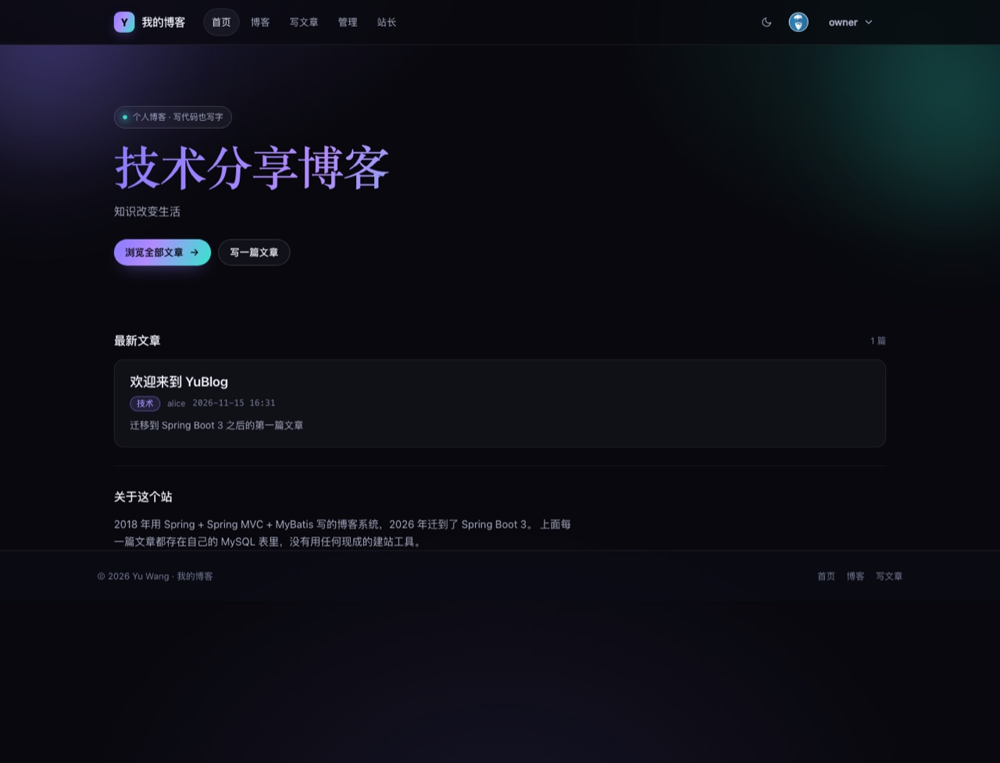
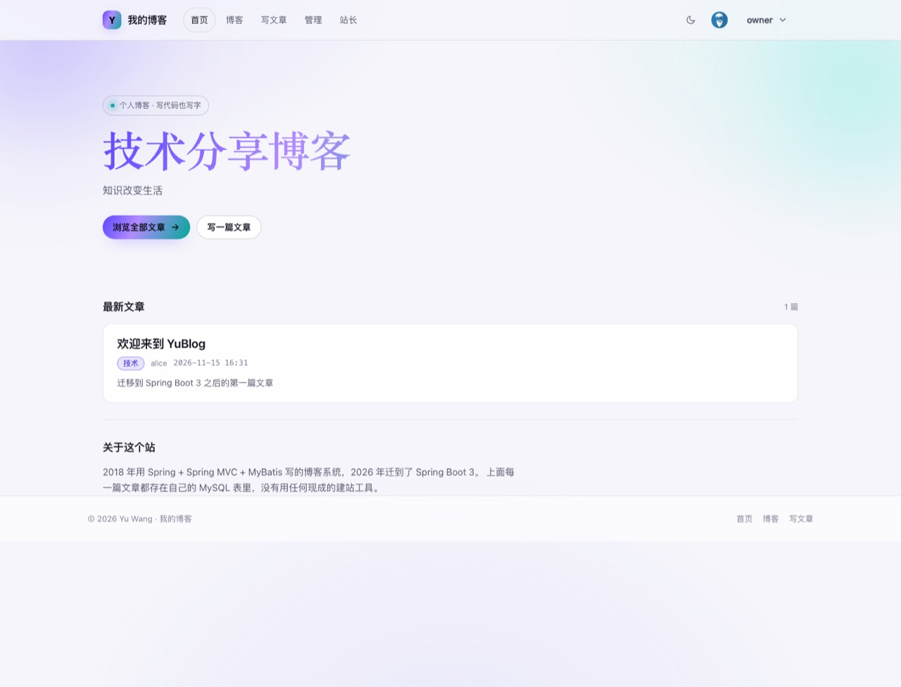
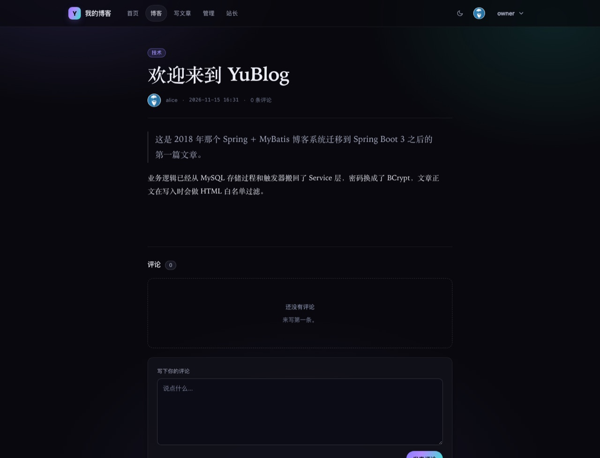
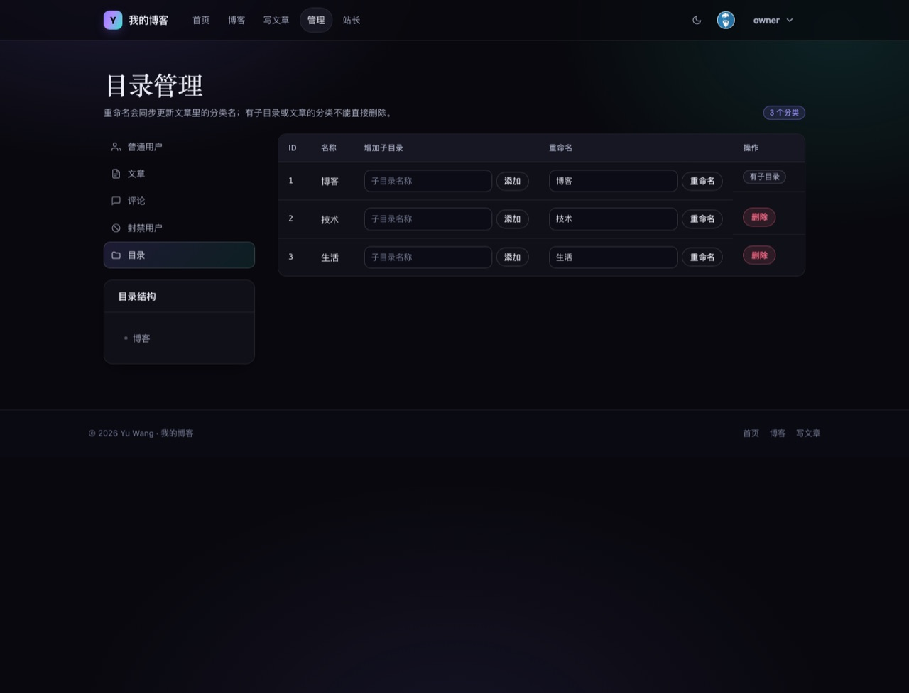

# YuBlog

一个自建的博客系统：写文章、评论、分类树、管理员申请审批、站内用户管理。
后端 Spring Boot 3 + MyBatis + MySQL，前端 Thymeleaf + 手写 CSS/JS。

## 技术栈

| | |
|---|---|
| 语言 / 框架 | Java 17，Spring Boot 3.5（内嵌 Tomcat） |
| 持久层 | MyBatis 3（XML mapper），MySQL 8 / H2 |
| 视图 | Thymeleaf 3.1，手写 CSS 与少量原生 JS（无前端框架、无 CDN） |
| 安全 | Spring Security 6：表单登录、三级角色、BCrypt、CSRF |
| 构建 | Maven，可执行 jar；GitHub Actions 跑 `mvn verify` |
| 上传 | 头像存 webapp 之外的目录，后缀白名单 + 图片解码 + 裁剪 |

## 界面

深色是默认，右上角可切浅色，选择记在 localStorage。

| 首页（深色） | 首页（浅色） |
|---|---|
|  |  |

| 文章页（带阅读进度条） | 管理台 · 目录 |
|---|---|
|  |  |

## 快速开始

### 方式一：demo，零依赖（H2 内存库，约 30 秒）

```bash
mvn spring-boot:run -Dspring-boot.run.profiles=demo
```

打开 <http://localhost:8080>。数据库在内存里，每次启动都是干净的种子数据。

### 方式二：MySQL

```bash
mysql -uroot -p -e "CREATE DATABASE blog DEFAULT CHARSET utf8mb4"
mysql -uroot -p blog < src/main/resources/schema.sql

DB_USERNAME=root DB_PASSWORD=你的密码 mvn spring-boot:run
```

### 默认账号

| 账号 | 密码 | 角色 |
|---|---|---|
| `owner` | `owner123456` | 站长（OWNER + ADMIN + USER） |
| `admin` | `admin123456` | 管理员（ADMIN + USER） |
| `alice` | `alice123456` | 普通用户（USER） |

> 这三个账号是种子数据，用于本地体验。真实部署请先改密码。
> 头像上传目录默认 `./data/user-pic`，可以用 `UPLOAD_DIR` 或 `yublog.upload-dir` 改。

## 页面与角色

| 路径 | 谁能进 |
|---|---|
| `/`、`/blog`、`/article`、`/user`、`/write-article` | 登录用户 |
| `/admin?page=user\|article\|comment\|user-disable\|catalog` | `ROLE_ADMIN` |
| `/owner?page=admin-request\|admin-list` | `ROLE_OWNER` |
| `/login`、`/register` | 所有人 |

普通用户可以申请成为管理员（个人面板里的「申请成为管理员」），站长在
`/owner?page=admin-request` 审批，审批通过后本人需要重新登录。

## 目录结构

```
src/main/java/cn/net/wangshifu/
├── config/       SecurityConfig（安全规则）、WebConfig（BCrypt、头像资源映射）、YuBlogProperties
├── controller/   9 个控制器，构造器注入，只做参数绑定和视图选择
├── service/      UserService / ArticleService / CommentService / CatalogService /
│                 AdminApplyService / AvatarStorage / CurrentUser / BlogInfoService
├── dao/          6 个 MyBatis Mapper 接口
├── model/        5 个 POJO
├── util/         CatalogUtil（分类树）、HtmlSanitizer（正文白名单过滤）
├── web/          GlobalModelAdvice（公共模型属性）、GlobalExceptionHandler、CatalogPageModel
├── security/     AuthUser（登录主体，带用户 id）
└── exception/    NotFound / Forbidden / Validation
src/main/resources/
├── templates/    20 个 Thymeleaf 模板，公共部分在 fragments.html
├── static/       css / js / img
├── mapper/       6 个 MyBatis XML
├── schema.sql    MySQL 生产库初始化脚本
└── schema-h2.sql demo 与测试用的 H2 脚本
```

## 测试

```bash
mvn test
```

36 个用例，覆盖：

| 测试类 | 覆盖 |
|---|---|
| `AuthFlowTest` | 未登录跳转、登录、错误密码、注册、密码强度校验 |
| `SecurityRulesTest` | USER/ADMIN/OWNER 三级越权、CSRF 必须带 token、正文 XSS 过滤 |
| `UploadAndProfileTest` | `.jsp` 上传被拒且不留文件、PNG 上传落到配置目录、默认头像 |
| `CatalogAndErrorHandlingTest` | 未知分类、非数字参数返回 400、文章不存在返回 404、分类增删 |
| `HtmlSanitizerTest` | 白名单保留编辑器标签、剥掉 script / onerror / javascript: |
| `PageRendersTest` | 以站长身份把 17 个页面全渲染一遍 |
| `UserJourneyTest` | 发文、评论、改名、改密码、退出、封禁、申请管理员、清空内容 |

测试用 H2（`src/test/resources/application-test.yml`），不依赖本机 MySQL。

## 已知限制

这些是**故意没做**的，不是遗漏：

- **没有分页**：`/blog` 一次查全表，文章多了会慢；
- **没有文章编辑**：只能删了重发；
- **编辑器是自研的**：textarea + 插入 HTML 片段的按钮 + 实时预览，不是所见即所得；
- **会话存在内存里**：多实例部署需要 Spring Session + Redis；
- **没有限流和登录失败锁定**：可以暴力试密码；
- **没有找回密码 / 邮箱验证**；
- **前端没有构建工具**：没有 npm / 打包器，改样式直接改 `yublog.css`。

## License

没有 LICENSE 文件。如果要复用，请先加一个。